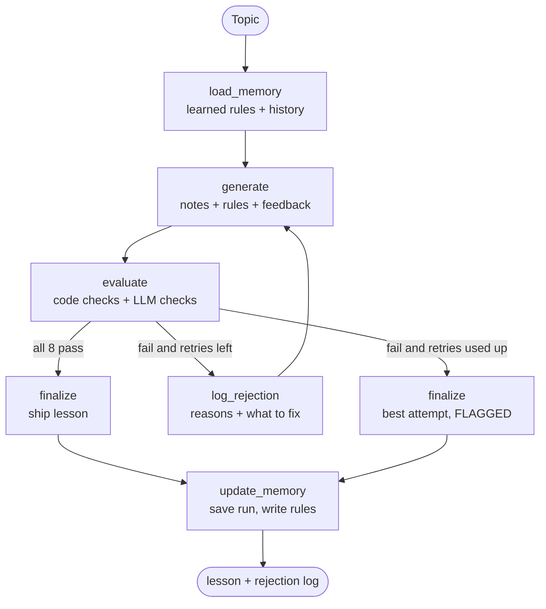

# Self-Evaluating Lesson Content Generator

An agentic system that **writes a beginner lesson, judges its own work against a hard pass/fail rubric,
rewrites it when it fails, and learns from its mistakes across runs.**
Built for the NxtWave "GenAI Engineer - Content Systems" take-home. Topic: **Introduction to RAG**.

```
INPUT topic -> GENERATE -> EVALUATE (8 hard checks) -> pass? -> SHIP lesson + rejection log -> update MEMORY
                  ^             |                        |
                  |             fail, retries left       fail, no retries left
                  +-- feedback -+                        -> ship best attempt, FLAGGED for a human
```

## What is in the box

| Requirement in the brief | Where it lives |
|---|---|
| Generate a standalone beginner lesson | `src/generator.py`, `prompts/generator_v1.md` |
| Evaluate with hard pass/fail checkpoints | `src/rubric.py` (8 checks), `src/checks.py` (code), `src/evaluator.py` (code + LLM) |
| Regenerate on fail, max 1-2 retries, always terminates | `src/graph.py` (`route_after_evaluate`), `--max-retries` (default 2, hard cap 3) |
| Output: passing lesson + rejection log | `outputs/final_lesson.md`, `outputs/rejection_log.md` |
| Self-evolving | `src/refiner.py`: repeated failures become new generator rules |
| Memory across runs | `src/memory.py` -> `memory/*.json` and `memory/prompt_changelog.md` |
| Grounded and accurate | `prompts/reference_notes.md` (18 verified facts the evaluator checks against) |
| Deliberate error demo | `python main.py --inject-error` |
| Proof the evaluator works | `python main.py --eval-suite` (5 broken lessons + 1 control) |
| Stack | Python + LangGraph + any LLM (Gemini / Groq / OpenAI / Claude) |

## Quick start (5 minutes)

```bash
# 1. Python 3.10+ required
python -m venv .venv
source .venv/bin/activate            # Windows: .venv\Scripts\activate
pip install -r requirements.txt

# 2. Try the whole loop with NO API key (fake model, tests the plumbing only)
python main.py --mock

# 3. Add a real key
cp .env.example .env                 # Windows: copy .env.example .env
#    edit .env: set LLM_PROVIDER and the matching API key

# 4. Real run
python main.py --topic "Introduction to RAG"
LLM_TIMEOUT=90 LLM_MAX_RETRIES=2 python main.py --topic "Introduction to RAG"
```
python main.py --inject-error --max-retries 2
Outputs appear in `outputs/`. Read the full guide in `docs/STEP_BY_STEP_GUIDE.md`.

## Commands

| Command | What it does |
|---|---|
| `python main.py --mock` | Full loop with a fake model. No key, no internet. |
| `python main.py` | Real run. Writes `outputs/final_lesson.md` and `outputs/rejection_log.md`. |
| `python main.py --inject-error` | Plants a wrong sentence in a good lesson; shows the evaluator catching it and the loop fixing it. |
| `python main.py --eval-suite` | Runs the evaluator on deliberately broken lessons. Must catch each one. |
| `python main.py --evaluate-only FILE.md` | Judge any lesson file. |
| `python main.py --show-memory` | Print learned rules, failure counts and run history. |
| `python main.py --reset-memory` | Start learning from scratch. |
| `python main.py --glossary Telugu` | Bonus: add a vernacular glossary after the lesson passes. |
| `python -m unittest discover -s tests -v` | 19 tests, run offline. |

## The rubric (hard pass/fail, no partial credit)

| ID | Checkpoint | Judged by |
|---|---|---|
| C1 | Covers what it is, why it matters, how it works | LLM |
| C2 | Every fact is consistent with the reference notes (no hallucination) | LLM + grounding notes |
| C3 | Every technical term is explained at first use; simple words | **code + LLM** |
| C4 | Average sentence <= 15 words; <= 10% over 25 words | **code** |
| C5 | At least 2 concrete examples (one Indian everyday context) + an analogy | LLM |
| C6 | 7 required sections in order; each builds on the last | **code + LLM** |
| C7 | Recap (>= 3 points) and 3 self-check questions | **code** |
| C8 | 500 to 1200 words | **code** |

## Architecture



Design reasoning and trade-offs: `docs/architecture.md`.

## Honest limitations

- An LLM reviewer can be too lenient or too strict. Mitigations: a different evaluator model at temperature 0,
  half the rubric is plain code, the evaluator fails closed, and `--eval-suite` proves it catches known errors.
- The jargon check is a heuristic (it looks for "is / means / called" near the first use). The LLM judges meaning.
- Grounding notes were written by hand. For a new topic they must be replaced with verified notes.
- The mock model only tests the plumbing. It says nothing about real lesson quality.
- Sentence-length averages can be gamed with many very short sentences. A human reviewer is still needed.

## Next steps

LangSmith tracing, RAGAS-style faithfulness scoring, a human review queue for flagged lessons, a larger
labelled eval set, and generating MCQs and coding exercises through the same loop.
